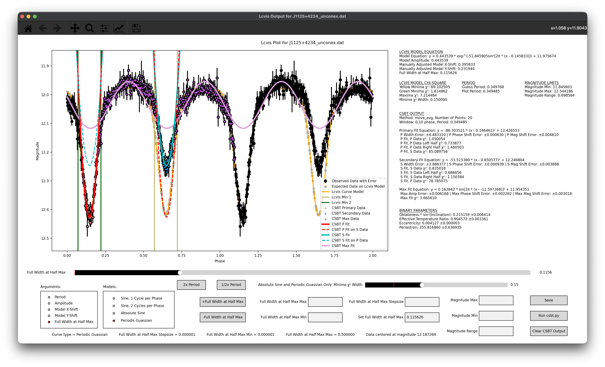
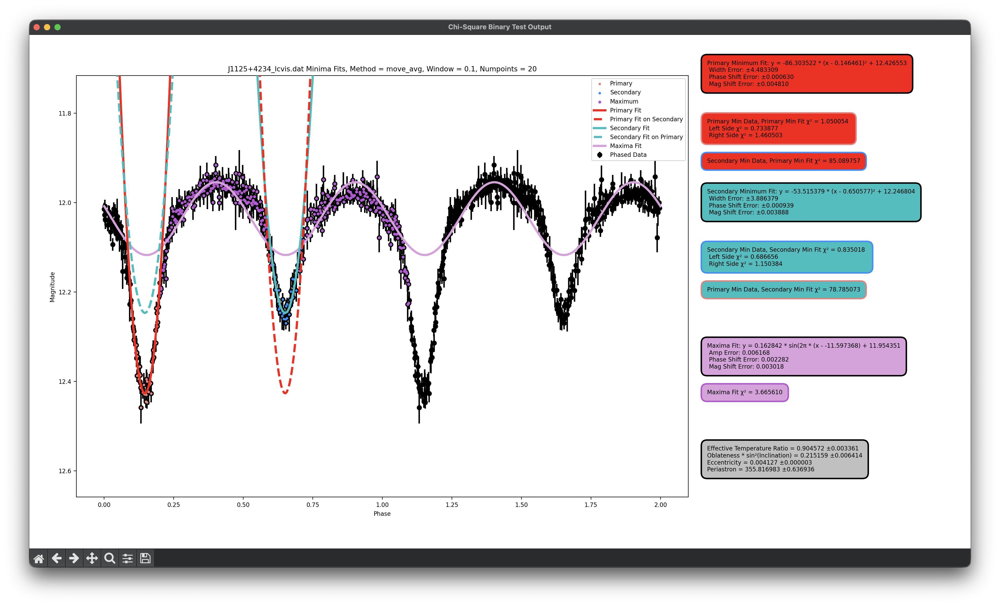

# Variable Star Light Curve Analysis

## Project Overview

This repository showcases my contributions to the development and improvement of Python-based software for analyzing astronomical light curves, completed during my undergraduate research at John Carroll University.

The research focused on variable stars, particularly eclipsing binary systems, using observational data from the Robotic Optical Transient Search Experiment (ROTSE-I) telescope.

My work involved expanding existing analysis programs to improve light curve visualization, model fitting, feature detection, and the extraction of physical parameters from observational data.

The software incorporates numerical and scientific computing techniques using Python, NumPy, SciPy, and Matplotlib.

**Original Project:** [ROTSEANA](https://github.com/rotsehub/rotseana)

**Note:** These programs were originally developed collaboratively. This repository highlights my modifications and additions to the existing research software.

## Technical Contributions

### 1. Interactive Light Curve Visualization and Modeling (`lcvis.py`)

Expanded an existing Python visualization program to support interactive analysis and model fitting of variable star light curves.

Key contributions:
- Developed interactive controls for manually adjusting mathematical models to fit observed light curve data.
- Implemented fitting calculations and chi-square statistics to evaluate agreement between models and observations.
- Integrated functionality from `csbt.py` into the visualization interface, allowing users to perform additional fitting analysis without leaving the active window.
- Expanded visualization and analysis capabilities to support interpretation of eclipsing binary light curves.

### 2. Light Curve Feature Detection and Physical Parameter Analysis (`csbt.py`)

Enhanced an existing light curve analysis program by implementing additional numerical methods and calculations.

Key contributions:
- Implemented a moving-average smoothing technique combined with SciPy's peak-detection functionality to identify light curve minima.
- Used numerical curve fitting to characterize features of eclipsing binary light curves.
- Added mathematical calculations for estimating physical parameters from fitted models.
- Implemented uncertainty propagation using fitted parameter covariance matrices and analytical derivatives.

### 3. Light Curve Data Filtering (`unconex2.py`)

Made targeted improvements to an existing astronomical data preprocessing program.

Key contribution:
- Added an optional filtering parameter to exclude the first two and last two observations from each night's observational data before subsequent processing.

## Technology Used

- **Programming Language:** Python
- **Numerical Computing:** NumPy, SciPy
- **Data Visualization:** Matplotlib
- **Symbolic Mathematics:** SymPy
- **Graphical User Interfaces:** PyQt5
- **Scientific Methods:** Curve fitting, peak detection, moving averages, chi-square analysis, uncertainty propagation

- ## Example Analysis

### Interactive Light Curve Visualization and Fitting

The screenshot below demonstrates the interactive Lcvis interface analyzing an eclipsing binary star light curve. The visualization combines observational data, manually adjusted mathematical models, and fitting results from the integrated CSBT analysis program.

The interface includes:
- **Interactive model adjustment:** Controls for modifying model parameters, selecting mathematical models, and adjusting the plotted period.
- **Integrated fitting analysis:** CSBT fitting results displayed alongside the manually adjusted Lcvis model.
- **Statistical output:** Chi-square values, fitted parameters, and estimated uncertainties.
- **Physical parameter estimation:** Calculated estimates of eclipsing binary system properties based on fitted light curve features.

### Standalone CSBT Analysis

The standalone Chi-Square Binary Test (CSBT) program performs numerical fitting and analysis of eclipsing binary star light curves.

The screenshot below demonstrates the analysis of the same variable star shown in the Lcvis example, using the moving-average-based feature detection method.

The visualization demonstrates several analytical capabilities:

- **Feature detection:** Uses moving-average smoothing and peak detection to identify important features of the light curve.
- **Eclipse fitting:** Fits mathematical models to the primary and secondary eclipse regions.
- **Maxima fitting:** Fits a sinusoidal model to characterize the light curve's maxima.
- **Statistical evaluation:** Reports chi-square statistics for fitted models and comparisons with observational data.
- **Uncertainty estimation:** Reports fitted parameter uncertainties derived from the fitting procedure.
- **Physical parameter estimation:** Calculates estimates of eclipsing binary system properties, including eccentricity, argument of periastron, effective temperature ratio, and an inclination-related oblateness parameter.

The fitted eclipse curves represent localized mathematical approximations rather than a single global physical model of the binary system.

## Development History

This repository contains selected programs from the collaborative [ROTSEANA research project](https://github.com/rotsehub/rotseana). My contributions were developed through multiple iterations, including feature additions, bug fixes, and revisions to existing analysis software.

The following Pull Requests document two of my major contributions to the original repository.

### [Pull Request #40 — CSBT Enhancements](https://github.com/rotsehub/rotseana/pull/40)

- Introduced moving-average-based feature detection to improve the identification of light curve extrema.
- Expanded the program's numerical analysis and reporting capabilities.

### [Pull Request #45 — LCVIS and CSBT Revisions](https://github.com/rotsehub/rotseana/pull/45)

- Restructured `lcvis.py` to reduce reliance on nested functions and improve code organization.
- Updated the graphical interface to use PyQt5 for dialog windows.
- Expanded interactive model selection, parameter adjustment, and period controls.
- Integrated CSBT fitting functionality into the LCVIS visualization interface.
- Improved saving functionality for analysis results and plots.
- Expanded CSBT analysis to include fitting of light curve maxima, physical parameter estimation, and uncertainty calculations.

These Pull Requests provide additional documentation of the implementation and evolution of the research software.
